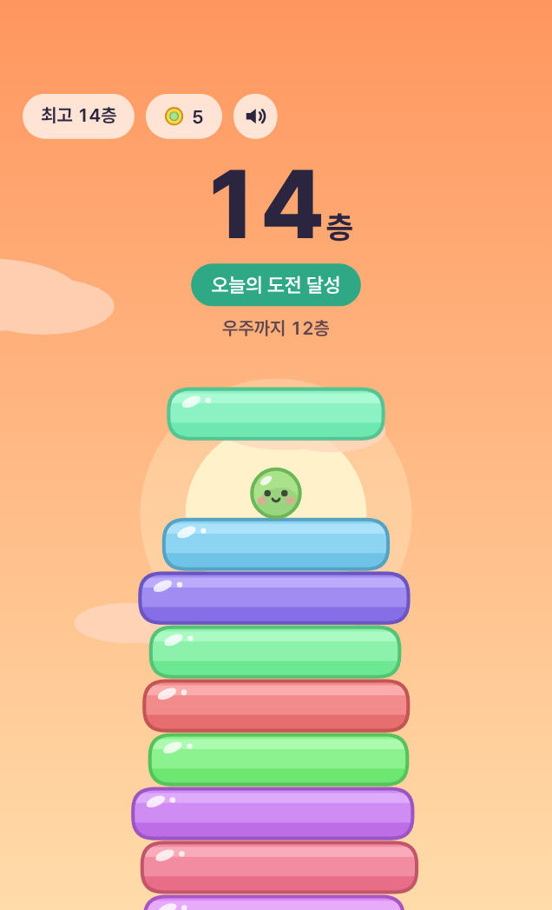

# 완두콩의 높이 쌓기 (pea-stack)

토스 앱인토스에 출시할 하이퍼캐주얼 쌓기 게임입니다.
화면을 꾹 눌러 막대를 키우고, 아래층과 같은 폭일 때 손을 떼서 완두콩을 우주까지 올려 보냅니다.

<p>
  
  
  
</p>

## 현재 상태

- [x] 게임 규칙 확정 (꾹 눌러 채우기)
- [x] React + 앱인토스 SDK 3.x 프로젝트, `pea-stack.ait` 빌드
- [x] 검수 기준 반영 (소리 On/Off·백그라운드 정지, 종료 확인, 사용자 식별, 안전 영역 등)
- [x] 보상형 광고(이어하기), 리더보드, 기록 공유
- [x] 콘솔 등록 이미지 (`store/`)
- [x] 등급분류용 안드로이드 프로젝트 (`android/`)
- [ ] 콘솔 등록, 등급분류, 광고 그룹 ID, 토스 앱 테스트 → **[docs/LAUNCH.md](docs/LAUNCH.md)**

## 게임 규칙

- 누르는 동안 막대가 양옆으로 자라고, 손을 떼면 내려앉습니다.
- 아래층과 폭이 같으면(오차 3.5% 이내) "딱!", 3번 연속부터는 딱마다 폭이 6px씩 회복됩니다.
- 틀리면 틀린 폭의 1.4배만큼 탑이 좁아집니다. 난이도 숫자는 `src/game/engine.ts`의 `TUNING`에 모여 있습니다.
- 탑이 16px보다 가늘어지거나 아래층의 1.9배까지 누르고 있으면 끝납니다.
- 누르는 동안 음이 올라가고, 폭이 딱 맞는 순간의 음 높이(라, 440Hz)는 항상 같습니다.
- 하늘 3단계: 파란 하늘 → 노을(12층) → 우주(26층).
- 오늘의 도전: 처음엔 10층, 이후 최고 기록의 85% 근처(날짜마다 -2~+3층). 하루 동안은 고정.
- 코인: 3층마다 1, 딱마다 1. **층·딱 코인은 하루 첫 2판만** 받아요(3판째부터는 0).
  오늘의 도전 달성 20은 판 수와 상관없이 하루 한 번. 하루 30개 남짓 모여요.
  출석 보상: 그날 첫 판 시작 때 +5, 연속 7일째마다 +20 더. 0층에서 끝난 판은 2판에 세지 않음.
  결과 화면에서 광고를 보면 그 판 코인 2배. 규칙 숫자는 `src/game/progress.ts`의 `COIN_RULES`.
- 꾸미기: 콩 12종, 소품 13종(+없음). 뽑기 없이 코인으로 바로 구매. 목록과 가격은 `src/game/cosmetics.ts`.
  - 콩: 완두콩(기본) 메주콩 30, 녹두 40, 팥 60, 땅콩 80, 강낭콩 100, 민트콩 120, 검은콩 150, 하늘콩 180, 솜사탕콩 220, 황금콩 300, 무지개콩 450
  - 소품: 새싹 20, 리본 40, 꽃핀 50, 동그란 안경 60, 고양이 귀 80, 털모자 100, 선글라스 120, 고깔모자 140, 밀짚모자 160, 헤드폰 180, 학사모 200, 천사 링 250, 왕관 350
- 광고(이어하기, 코인 2배)는 각각 판당 1번, 결과 화면에서만 나옵니다.

## 명령어

```bash
npm install
npm run dev            # 개발 서버 (오른쪽 아래 AIT 버튼으로 토스 기능 흉내)
                       # ?demo=30 을 붙이면 30층부터 시작 (개발 서버에서만)
npm run build          # dist/ + pea-stack.ait
npm run deploy         # ait deploy (콘솔 API 키 필요)
npm run lint
npm run android        # 등급분류용 안드로이드 앱: 빌드 → 복사 → Android Studio 열기
```

환경 변수: `.env.example`을 `.env`로 복사하고 `VITE_REWARDED_AD_GROUP_ID`에 보상형 광고 그룹 ID를 넣습니다.
Node 24 이상을 권장합니다.

## 폴더

```
src/
  App.tsx              화면(시작·HUD·결과·종료 확인)과 입력, 앱 상태 처리
  game/engine.ts       게임 규칙, 카메라, 효과
  game/draw.ts         하늘·화분·젤리 막대·완두콩 그리기 (이미지 파일 없음)
  game/sound.ts        Web Audio 효과음 (음원 파일 없음)
  game/progress.ts     최고 기록, 오늘의 도전, 연속 출석, 코인
  game/cosmetics.ts    꾸미기 목록(콩·소품)과 소품 그리기
src/Shop.tsx           꾸미기 화면
  platform/toss.ts     앱인토스 SDK 감싸기: 햅틱, 저장소, 광고, 리더보드, 공유, 화면
store/                 콘솔 등록 이미지 (로고·썸네일·스크린샷)
tools/brand.html       등록 이미지를 게임 그리기 코드로 다시 만드는 페이지
assets/                안드로이드 앱 아이콘 원본
android/               원스토어 등급분류용 Capacitor 안드로이드 프로젝트
prototype/             초기 한 장짜리 HTML 프로토타입
docs/LAUNCH.md         출시까지 남은 일
```

## 메모

- SDK 함수는 토스 앱 밖에서 예외를 던질 수 있어 `platform/toss.ts`에서 모두 감싸고, 브라우저 기능으로 대체합니다.
- 광고 ID 같은 키와 안드로이드 서명 키는 커밋하지 않습니다.
- 글꼴: Pretendard (SIL Open Font License 1.1)
