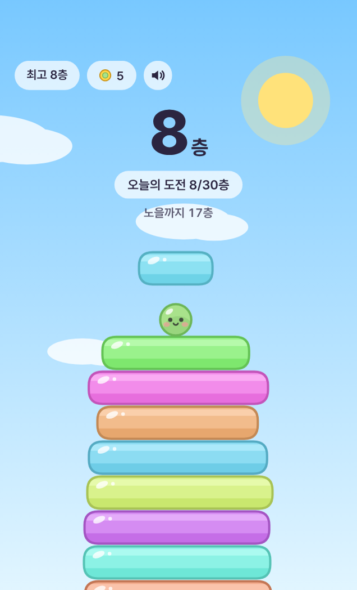
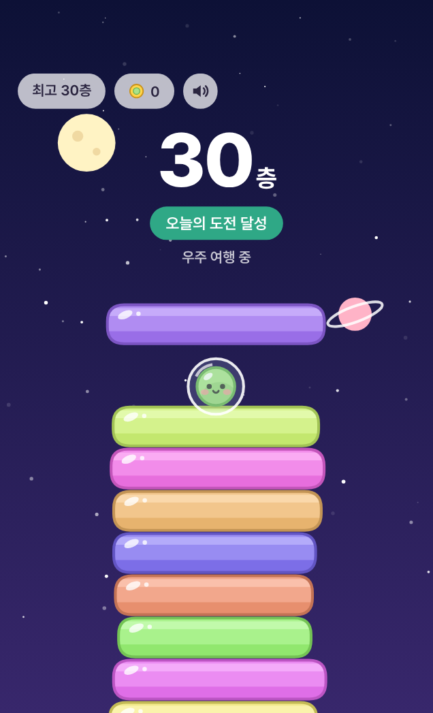

# 완두콩의 높이 쌓기 (pea-stack)

토스 앱인토스에 출시할 하이퍼캐주얼 쌓기 게임입니다. 원스토어에는 웹게임으로 출시했어요.
화면을 꾹 눌러 막대를 키우고, 아래층과 같은 폭일 때 손을 떼서 완두콩을 우주까지 올려 보냅니다.

<p>
  
  
  
</p>

## 현재 상태

현재 버전: **v5.2** (2026-11-18). 작업 기록은 [docs/PROGRESS.md](docs/PROGRESS.md).

- [x] 게임 규칙 확정 (꾹 눌러 채우기), 층수에 따라 점점 어려워지는 난이도
- [x] React + 앱인토스 SDK 3.x 프로젝트, `pea-stack.ait` 빌드
- [x] 검수 기준 반영 (소리 On/Off·백그라운드 정지, 종료 확인, 사용자 식별, 안전 영역 등)
- [x] 보상형 광고(이어하기, 코인 2배), 리더보드, 기록 공유, 광고 그룹 ID 연결
- [x] 코인·출석·오늘의 도전·꾸미기
- [x] 콘솔 등록 이미지 (`store/`)
- [x] 원스토어 웹게임 출시 (판매중) — https://hhhv-v.github.io/pea-stack/
- [x] 게임 등급분류: GRAC ONIA-SG-261117-0003 (2026-11-17, 전체이용가)
- [ ] 앱인토스 콘솔에 v5.1 업로드, 토스 앱 테스트, 등급분류 정보 입력, 스크린샷 교체, 검토 요청
- [ ] 사업자·정산 정보 등록 → **[docs/LAUNCH.md](docs/LAUNCH.md)**

## 게임 규칙

- 누르는 동안 막대가 양옆으로 자라고, 손을 떼면 내려앉습니다.
- 아래층과 폭이 같으면 "딱!", 틀리면 폭이 좁아져요. 자세한 숫자는 아래 [판정과 난이도](#판정과-난이도).
- 탑이 16px보다 가늘어지면 끝납니다. 아래층의 1.9배까지 누르고 있으면 그 자리에서 놓여요.
- 누르는 동안 음이 올라가고, 폭이 딱 맞는 순간의 음 높이(라, 440Hz)는 항상 같습니다.
- 하늘 3단계: 파란 하늘 → 노을(25층) → 우주(60층).
- 오늘의 도전: 처음엔 30층, 이후 최고 기록의 85% 근처(날짜마다 -4~+6층, 20~200층). 하루 동안은 고정.
- 코인 (`src/game/progress.ts`의 `COIN_RULES`, `ATTEND_RULES`)

  | 받는 방법 | 코인 | 조건 |
  |---|---|---|
  | 5층마다 | 1 | 하루 첫 3판만, 판당 상한 없음 |
  | 딱 10번마다 | 1 | 하루 첫 3판만 |
  | 오늘의 도전 달성 | 20 | 하루 한 번, 판 수와 상관없음 |
  | 출석 | 5 | 그날 첫 판 시작 때 |
  | 연속 출석 7일째마다 | +20 | 출석 5에 더해서 |
  | 결과 화면 광고 | 그 판 코인 ×2 | 판당 한 번 |

  - 4판째부터는 층·딱 코인이 0이에요. 0층에서 끝난 판은 코인 판으로 세지 않아요. 이어하기를 해도 판 수는 늘지 않아요.
  - 보통 사람(85층 안팎) 기준으로 판당 약 20개, 하루 90개 안팎이 모여요.
- 꾸미기: 콩 12종, 소품 13종(+없음). 뽑기 없이 코인으로 바로 구매. 목록과 가격은 `src/game/cosmetics.ts`.
  - 콩: 완두콩(기본), 메주콩 60, 녹두 80, 팥 120, 땅콩 160, 강낭콩 200, 민트콩 240, 검은콩 300, 하늘콩 360, 솜사탕콩 440, 황금콩 600, 무지개콩 10,000
  - 소품: 새싹 40, 리본 80, 꽃핀 100, 동그란 안경 120, 고양이 귀 160, 털모자 200, 선글라스 240, 고깔모자 280, 밀짚모자 320, 헤드폰 360, 학사모 400, 천사 링 500, 왕관 10,000
  - 가격 합계 약 25,000코인(최고급 두 개 20,000 포함). 하루 90개 기준 최고급 하나에 약 110일, 나머지 전부는 약 60일.
- 광고(이어하기, 코인 2배)는 각각 판당 1번, 결과 화면에서만 나옵니다.

## 판정과 난이도

숫자는 모두 `src/game/engine.ts`의 `TUNING`에 있어요.

### 판정
- 손을 뗀 순간 **막대 폭과 아래층 폭의 차이**만 봐요. 위치는 자동으로 가운데 정렬돼요.
- **딱!**: 폭 차이가 `max(3.5px, 아래층 폭 × 판정 비율)` 이하면 아래층과 같은 폭으로 쌓여요.
- **연속 딱**: 2번 연속부터 딱마다 폭이 10px씩 넓어져요(처음 폭까지만).
- **실수**: 새 폭 = 아래층 폭 − (틀린 폭 × 벌칙 배수). 넘친 쪽이든 모자란 쪽이든 똑같이 계산해요.
- **끝**: 새 폭이 16px보다 좁아지면 게임 오버.

### 층수별 난이도
0층부터 140층(`ramp`)까지 일정하게 조금씩 어려워지고, 140층부터는 그대로예요. 갑자기 어려워지는 구간은 없어요.

| 층 | 딱 판정 비율 | 허용 폭* | 실수 벌칙 | 막대 속도(px/s) |
|---|---|---|---|---|
| 1 | ±11% | ±25px | 0.25배 | 116 |
| 20 | ±10% | ±23px | 0.34배 | 139 |
| 40 | ±9% | ±21px | 0.44배 | 163 |
| 70 | ±7.5% | ±17px | 0.57배 | 199 |
| 100 | ±6% | ±14px | 0.71배 | 235 |
| 140~ | ±4% | ±9px | 0.9배 | 280(최대) |

\* 폭이 처음 폭(일반 폰 기준 약 228px, 화면 폭의 58%, 최대 250px)일 때. 폭이 좁아지면 허용 폭도 같이 줄어요.

- 막대 속도 = `115 + 층 × 1.2`(최대 280)에 매번 **0.75~1.35배 무작위**를 곱해요. 박자로 외울 수 없어요.
- 실수 벌칙 예: 20px 틀렸을 때 1층은 5px, 140층은 18px 좁아져요.

### 목표 기록
- 시뮬레이션(친구들 v4 실제 기록으로 보정): 서툰 사람 ~70층, 보통 ~85층, 잘하는 사람 ~120층.
- 실제 플레이(v5, 2026-11-18): 만든 사람 137층, 친구 87층. 목표 범위 안이라 이대로 출시하기로 함.

### 조정 방법
- 초반이 너무 어렵다 → `perfectRatio` 시작값(0.11)을 올려요.
- 잘하는 사람이 끝없이 간다 → `ramp`(140)를 줄이거나 `perfectRatio` 끝값(0.04)을 내려요.
- 실수 한 번이 너무 아프다 → `missPenalty` 값을 내려요.

## 명령어

```bash
npm install
npm run dev            # 개발 서버 (오른쪽 아래 AIT 버튼으로 토스 기능 흉내)
                       # ?demo=30 을 붙이면 30층부터 시작 (개발 서버에서만)
npm run build          # dist/ + pea-stack.ait (앱인토스 콘솔에 올리는 파일)
npm run build:web      # 원스토어 웹게임: dist-web/ (원스토어 H5 SDK 포함, /pea-stack/ 경로)
                       # → dist-web 내용을 gh-pages 브랜치에 올려 배포
npm run deploy         # ait deploy (콘솔 API 키 필요)
npm run lint
npm run android        # (예전) 등급분류용 안드로이드 앱. 웹게임으로 등급을 받아서 지금은 필요 없음
```

환경 변수: `.env.example`을 `.env`로 복사하고 `VITE_REWARDED_AD_GROUP_ID`에 보상형 광고 그룹 ID를 넣습니다.
Node 24 이상을 권장합니다.

## 폴더

```
src/
  App.tsx              화면(시작·HUD·결과·종료 확인)과 입력, 앱 상태 처리
  game/engine.ts       게임 규칙, 카메라, 효과
  game/draw.ts         하늘·화분·젤리 막대·완두콩 그리기 (이미지 파일 없음)
  game/sound.ts        Web Audio 효과음 (음원 파일 없음)
  game/progress.ts     최고 기록, 오늘의 도전, 연속 출석, 코인
  game/cosmetics.ts    꾸미기 목록(콩·소품)과 소품 그리기
  Shop.tsx             꾸미기 화면
  platform/toss.ts     앱인토스 SDK 감싸기: 햅틱, 저장소, 광고, 리더보드, 공유, 화면
  platform/onestore.ts 원스토어 H5 SDK 연동 (원스토어 빌드에서만 사용)
store/                 앱인토스 콘솔 등록 이미지 (로고·썸네일·스크린샷)
store/onestore/        원스토어 등록 이미지 (9:16 스크린샷, 그래픽 이미지)
tools/brand.html       등록 이미지를 게임 그리기 코드로 다시 만드는 페이지
assets/                안드로이드 앱 아이콘 원본
android/               (예전) 등급분류용 Capacitor 안드로이드 프로젝트
prototype/             초기 한 장짜리 HTML 프로토타입
docs/LAUNCH.md         출시까지 남은 일
docs/PROGRESS.md       버전별 작업 기록
```

## 메모

- SDK 함수는 토스 앱 밖에서 예외를 던질 수 있어 `platform/toss.ts`에서 모두 감싸고, 브라우저 기능으로 대체합니다.
- 광고 ID 같은 키와 안드로이드 서명 키는 커밋하지 않습니다.
- 게임 캔버스는 `ResizeObserver`로 실제 크기를 계속 맞춰요. 토스 웹뷰에서 CSS보다 스크립트가 먼저 돌면
  캔버스가 기본 크기(300×150)로 잡혀 화면이 늘어나던 문제(v5)를 v5.1에서 고쳤어요.
- 글꼴: Pretendard (SIL Open Font License 1.1)
